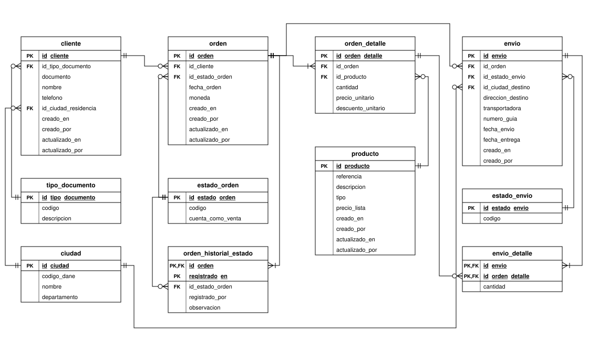

# Parte 1: modelo relacional de ventas por internet

## a) ¿Qué le mejoraría al modelo?

Están en orden de prioridad. Las tres primeras cambian lo que el modelo puede responder; las demás lo hacen confiable y escalable.

### 1. Nomenclatura estándar

Hoy conviven tres estilos: `IdCliente` (PascalCase), `Valor_Final` y `Tipo_Documento` (mayúscula con guion bajo), y tablas en plural en mayúscula sostenida (`CLIENTES`). Con varias personas escribiendo SQL eso termina en errores y en consultas que solo funcionan según cómo trate cada motor las mayúsculas.

La convención que propongo, y que aplico en el diagrama:

- `snake_case` en minúscula para tablas y columnas. No necesita comillas en ningún motor y se lee igual en SQL Server, PostgreSQL o un lakehouse.
- Tablas en singular: `cliente`, `orden`, `producto`.
- Llave primaria `id_<tabla>` y la FK con el mismo nombre que la PK a la que apunta (`orden.id_cliente` → `cliente.id_cliente`). Así el join se lee solo.
- Prefijos o sufijos con significado fijo: `fecha_` / `_en` para fechas, `valor_` / `precio_` para dinero, `es_` o `cuenta_como_` para booleanos.

### 2. Auditoría: cuándo, quién y qué cambió

Ninguna tabla registra cuándo se creó o modificó un registro ni quién lo hizo. Sin eso no hay forma de responder "¿quién cambió el precio de este producto?" o "¿quién aprobó esta orden?", ni de hacer cargas incrementales hacia una bodega de datos (no hay un campo con el que saber qué cambió desde la última carga).

- En las tablas transaccionales (`cliente`, `producto`, `orden`, `envio`): `creado_en`, `creado_por`, `actualizado_en`, `actualizado_por`.
- Para los cambios de estado, que son los que importan al negocio (validada, pagada, anulada, despachada), una tabla de solo inserción `orden_historial_estado` con fecha, usuario y observación. El estado actual queda en `orden`; el historial dice quién lo validó o lo cambió y cuándo.

### 3. Relación entre órdenes y productos

En la figura, `ORDENES` tiene `IdProducto`: cada orden lleva un solo producto. Un carrito con tres artículos termina en tres órdenes, y se pierde el concepto de compra (ticket promedio, número de órdenes, despacho conjunto). Además `IdProducto` no está marcado como FK.

La relación real orden-producto es muchos a muchos y se resuelve con una tabla de detalle:

- `orden`: la cabecera (cliente, fecha, estado, moneda). Una fila por compra.
- `orden_detalle`: una fila por producto dentro de la orden, con `cantidad`, `precio_unitario` y `descuento_unitario`.

El precio se guarda en el detalle tal como se cobró. Hoy `Valor_Final` se calcula con `Precio_Base` de `PRODUCTOS`: si mañana sube el precio, las ventas históricas cambian de valor. También es ambiguo si `Valor_Final` es por unidad o por la línea completa. Con el detalle, el valor de la línea es siempre `cantidad * (precio_unitario - descuento_unitario)` y el dinero va en `DECIMAL`, nunca en flotante.

### 4. Cardinalidad y relaciones

Revisando las relaciones de la figura:

| Relación | En la figura | Problema | Propuesta |
|---|---|---|---|
| cliente → orden | 1 a 0..N | Correcta | Se mantiene; `id_cliente` NOT NULL (no hay orden sin cliente) |
| producto → orden | 1 a 0..N | En realidad es N:M y la FK no está declarada | `orden_detalle` en el medio: orden 1 a 1..N detalle, producto 1 a 0..N detalle |
| orden → envío | 1 a 0..N | Permite varios envíos por orden pero no dice qué va en cada uno | `envio_detalle` (envío × línea de la orden, con cantidad) para despachos parciales. Si el negocio solo despacha completo, la regla es `UNIQUE (id_orden)` en `envio` y la relación queda 1 a 0..1 |
| cliente / envío → ciudad | texto libre | "Bogotá", "BOGOTA" y "Bogota D.C." son tres ciudades en un GROUP BY | Tabla `ciudad` con código DANE único |
| tipo de documento, estado del envío | texto libre | Valores inconsistentes | Catálogos `tipo_documento`, `estado_orden`, `estado_envio` |

Y las reglas que la base debe hacer cumplir, no la aplicación: FK declaradas en todas las relaciones, `UNIQUE (id_tipo_documento, documento)` en cliente, `CHECK (cantidad > 0)`, descuento entre 0 y el precio, y `fecha_entrega >= fecha_envio`.

### 5. Otras mejoras

- **Estado de la orden.** Sin él, cualquier reporte de ventas suma órdenes anuladas o devueltas. El catálogo `estado_orden` lleva la bandera `cuenta_como_venta`, así la regla de qué es una venta vive en un solo lugar.
- **Índices y escala.** Índice `(fecha_orden, id_estado_orden, id_cliente)` en `orden` e índices en las FK. Con volumen alto, particionar `orden` por mes de `fecha_orden`.
- **Separar lo transaccional de lo analítico.** Preguntas como la (b) deberían salir de un modelo estrella (`fact_venta` a grano línea, `dim_cliente`, `dim_producto`, `dim_fecha`) y no de la base que atiende el checkout.
- **Datos personales.** Documento, nombre, teléfono y dirección se marcan como datos sensibles y se restringe quién los lee.

### Diagrama del modelo mejorado



Editable en [diagramas/modelo_relacional_mejorado.drawio](diagramas/modelo_relacional_mejorado.drawio) (se abre en diagrams.net). El DDL completo está en [ddl_modelo_mejorado.sql](../sql/01_modelo_relacional/ddl_modelo_mejorado.sql).

## b) Query: 10 mejores clientes del último año por valor de compra

Dos definiciones antes del SQL:

- **Último año:** los 12 meses que terminan en la fecha de corte. Uso un rango semiabierto (`>= desde` y `< hasta`) sin funciones sobre `fecha_orden`, para que el motor pueda usar el índice y no se pierdan las órdenes del último día.
- **Valor de compra:** suma de cantidad × precio neto unitario.

### Sobre el modelo tal como está

Asumo que `Valor_Final` es el valor neto por unidad, como dice la anotación de la figura. Como no hay estado de la orden, no se pueden excluir anuladas.

```sql
SELECT TOP (10)
       c.IdCliente,
       c.Nombre,
       SUM(o.Cantidad * o.Valor_Final) AS valor_compra
FROM ORDENES o
JOIN CLIENTES c ON c.IdCliente = o.IdCliente
WHERE o.Fecha_Orden >= DATEADD(MONTH, -12, DATEADD(DAY, 1, CAST(GETDATE() AS DATE)))
  AND o.Fecha_Orden <  DATEADD(DAY, 1, CAST(GETDATE() AS DATE))
GROUP BY c.IdCliente, c.Nombre
ORDER BY valor_compra DESC, c.IdCliente;
```

### Sobre el modelo mejorado

Pensando en que lo ejecuta un sistema todos los días, lo dejo lo más simple posible ([top10_clientes.sql](../sql/01_modelo_relacional/top10_clientes.sql)):

```sql
SELECT c.id_cliente,
       c.nombre,
       SUM(d.cantidad * (d.precio_unitario - d.descuento_unitario)) AS valor_compra
FROM orden o
JOIN orden_detalle d ON d.id_orden = o.id_orden
JOIN estado_orden  e ON e.id_estado_orden = o.id_estado_orden
JOIN cliente       c ON c.id_cliente = o.id_cliente
WHERE o.fecha_orden >= :fecha_desde
  AND o.fecha_orden <  :fecha_hasta
  AND e.cuenta_como_venta = TRUE
GROUP BY c.id_cliente, c.nombre
ORDER BY valor_compra DESC, c.id_cliente
OFFSET 0 ROWS FETCH NEXT 10 ROWS ONLY;
```

Por qué así:

- **El periodo llega como parámetro.** La aplicación calcula `fecha_desde` y `fecha_hasta`, y la base no hace aritmética de fechas, que es justo lo que más cambia entre motores. Como consulta parametrizada, el motor reutiliza el plan en cada ejecución.
- **Sin CTE ni funciones de ventana.** Un `ROW_NUMBER()` obliga a ordenar a todos los clientes del periodo. Con `ORDER BY ... FETCH NEXT 10` el motor solo mantiene los 10 primeros mientras recorre.
- **Rango semiabierto sobre la columna sin funciones.** Aprovecha el índice y no pierde las órdenes del último día.
- **Desempate determinista.** `ORDER BY valor_compra DESC, c.id_cliente` devuelve siempre los mismos 10 clientes. Si el negocio quiere incluir a quienes empatan en el puesto 10, se usa `FETCH NEXT 10 ROWS WITH TIES` (PostgreSQL 13+, Oracle) o `TOP (10) WITH TIES` (SQL Server).
- **Portable.** `OFFSET ... FETCH` es SQL estándar: corre en PostgreSQL, SQL Server 2012+, Oracle 12c+ y DuckDB. En SQL Server el booleano es `BIT`, así que la condición queda `= 1`.

Para que escale:

- Índices `orden (fecha_orden, id_estado_orden, id_cliente)` y `orden_detalle (id_orden)`; en SQL Server, con `INCLUDE (cantidad, precio_unitario, descuento_unitario)` en el detalle para no ir a la tabla.
- Si el volumen crece mucho, una tabla `venta_cliente_mes` que se actualiza una vez al día con lo vendido por cliente y mes. El top de 12 meses pasa a sumar 12 filas por cliente en lugar de recorrer todas las líneas de venta.

El query está probado en [tests/test_modelo_relacional.py](../tests/test_modelo_relacional.py), con datos que cubren órdenes anuladas y devueltas, una orden un minuto antes del inicio del periodo, otra justo en el límite superior y dos empates.
