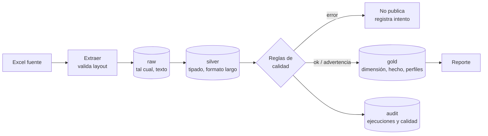

# Parte 2: ETL de normales climatológicas 1981-2010

Elegí **Evaporación** y **Evapotranspiración Potencial (ETP)**. Son los dos ítems con más física detrás: los dos miden cuánta agua puede devolver la superficie a la atmósfera, y eso depende de la energía disponible (radiación, temperatura) y de qué tan seco y en movimiento está el aire. Además se complementan: la evaporación se **mide** en un tanque con agua y la ETP se **estima** para una cobertura vegetal que no tiene restricción de agua. Compararlas en las estaciones que tienen las dos dice qué tan bien representa la estimación lo que pasa en campo.

- Reporte generado: [reports/clima/reporte_clima.md](../reports/clima/reporte_clima.md)
- Análisis: [más abajo](#análisis-de-resultados)

## Cómo correrlo

```bash
make install    # entorno y dependencias
make run        # ETL y reporte
make test       # pruebas de la parte 1 y la parte 2
```

La ETL devuelve código de salida 0 si publica o si no hay cambios y 1 si falla, así que se puede programar en cron o en cualquier orquestador sin envolverla.

## Diseño



**Herramienta.** Python (pandas para leer el Excel) y DuckDB como bodega local. Las transformaciones de gold están en SQL ([sql/02_etl_clima/gold](../sql/02_etl_clima/gold)), no en pandas: son las mismas que correrían en PostgreSQL, Databricks o Snowflake con cambios mínimos.

**Capas.**

| Capa | Qué guarda | Por qué |
|---|---|---|
| raw | Cada hoja tal como viene, todo como texto, con la fila de Excel | Cualquier dato se puede rastrear hasta su celda original |
| silver | `estacion` (una fila por código), `normal_mensual` (estación × variable × mes) y `normal_anual` | El formato largo permite agregar otra variable sin cambiar tablas; tipos y llaves declarados en [01_tablas.sql](../sql/02_etl_clima/silver/01_tablas.sql) |
| gold | `dim_estacion`, `fact_normal_mensual`, `perfil_estacion`, `resumen_departamento` | Lo que consume el reporte |
| audit | `etl_ejecucion` y `calidad_resultado` | Historial de cada corrida, también de las fallidas |

**Tasa diaria.** Los valores del archivo son totales mensuales. Comparar meses así es engañoso, porque febrero siempre "evapora menos" solo por tener 28 días. El hecho de gold guarda también `valor_diario` (mm/día), dividiendo por los días del mes (28,25 en febrero, para promediar los años bisiestos). Todo el análisis estacional usa esa tasa.

**Contrato de la fuente.** La estructura que se espera de cada hoja está en [config.py](../src/etl_clima/config.py): nombre de la hoja, título del bloque, unidad, cómo se compone el anual y rango físico válido. La extracción busca los bloques por su título y no por posición, y valida que los encabezados sean ENE...DIC y ANUAL. Si el archivo cambia de estructura, la carga falla con un mensaje claro en lugar de cargar datos corridos. Sumar otro ítem del archivo es agregar una entrada en esa configuración.

**Calidad.** Antes de publicar se evalúan 15 reglas ([calidad.py](../src/etl_clima/calidad.py)). Las de severidad *error* (código duplicado, coordenadas ilegibles o fuera del país, valores no numéricos o fuera de rango físico) cancelan la publicación. Las de severidad *advertencia* (anual distinto de la suma de los meses, estación descrita distinto en las dos hojas, evaporación y ETP de órdenes muy diferentes) se publican y quedan registradas con ejemplos. Las constraints de silver (PK, NOT NULL, CHECK) son una segunda barrera dentro de la transacción.

**Escribir, auditar, publicar.** raw, silver y gold se reemplazan en una sola transacción. Si algo falla, se hace rollback y queda la versión publicada anterior; la bitácora se escribe aparte para que el intento fallido quede registrado.

**Idempotencia.** Cada carga guarda el sha256 del archivo. Con el mismo archivo no se recarga (estado `omitida`); `--forzar` obliga a recargar. Como cada corrida reemplaza completo, correrla dos veces nunca duplica datos.

**Escalabilidad.** Para este volumen (2.020 estaciones, 28.368 filas mensuales) DuckDB sobra. Si llegaran más archivos (por ejemplo las normales 1991-2020, o series diarias), los cambios serían: agregar `periodo` a la llave de silver, cargar de forma incremental por archivo en lugar de reemplazar todo y particionar el hecho por periodo y variable. El SQL de gold no cambia.

## Lo que encontré en la fuente

Ninguna regla bloqueante falló. Lo que sí hay que manejar a propósito:

- **El anual publicado de evaporación no es la suma de los meses.** En 263 de las 412 estaciones la columna ANUAL se aparta más de 5% de la suma de ENE a DIC. La diferencia mediana es de -6,5%, llega a -29% y **nunca es positiva**. Lo más probable es que el anual se haya calculado solo con los años completos, y cada mes con todos los datos disponibles. Para comparar variables uso la suma de los meses y guardo el valor publicado al lado (`evaporacion_anual_publicada_mm`). En la ETP, el anual coincide exactamente con la suma.
- **La ETP es un valor estimado, no medido.** De las 1.608 estaciones que solo aparecen en la hoja de ETP, el 91% son pluviométricas o pluviográficas, es decir, estaciones que solo miden lluvia. Sus valores vienen con un decimal y siguen muy de cerca la altura (ver análisis). La ETP se calculó con un método que el archivo no documenta, y lo tengo en cuenta al interpretarla.
- **Leyenda debajo de los datos.** Las últimas filas de cada hoja son la convención de categorías de estación. Se descartan porque el código no es numérico, y se cuentan en el log.
- **El nombre de la estación no la identifica.** Hay 169 nombres repetidos ("Brisas Las" existe en Ansermanuevo, Villamaría y Segovia). La llave es el código.
- **Una misma estación con dos nombres.** El código 48015010 se llama "A.Vasquez Cobo" en Evaporación y "Apto Vasquez Cobo" en ETP; mismas coordenadas y elevación. Queda como advertencia.
- **Coordenadas en texto** (`72°47'22,5"W`) con coma decimal en los segundos. El parser acepta coma o punto.
- Departamentos sin tildes y uno truncado ("San Andres Providencia y Sta C"). Los dejo como vienen: corregirlos es una decisión de negocio, no de la ETL.

## Análisis de resultados

Las cifras salen de la capa gold; el detalle está en el [reporte](../reports/clima/reporte_clima.md).

### 1. Con la altura baja la demanda de evaporación


Las dos variables bajan casi al mismo ritmo, unos **0,6 mm/día por cada kilómetro** de altura: la ETP 0,57 y la evaporación 0,59. Es lo que se espera físicamente: con la altura baja la temperatura, y con ella la presión de vapor de saturación y la energía que el aire puede usar para evaporar. A nivel del mar ambas rondan 4,1 a 4,2 mm/día, y a 4.000 m quedan cerca de 1,9.

La diferencia está en la dispersión. La altura explica el 78% de la variación de la ETP, pero solo el 36% de la evaporación medida. En la ETP los puntos forman franjas paralelas, y dentro de los departamentos andinos la altura explica alrededor del 90% (Cundinamarca 0,92, Santander 0,91, Huila 0,90). Eso es coherente con un valor que se estima a partir de la altura. La evaporación real, en cambio, a la misma altura puede ir de 2 a 8 mm/día: depende también del viento, de la humedad del aire y de la nubosidad.

Los extremos lo muestran:

- La mayor evaporación es la de Manaure (La Guajira, 1 m): 2.903 mm al año, casi 8 mm/día. Le siguen La Gloria y Valledupar en el Cesar. Es el Caribe seco, con sol, viento y aire poco húmedo.
- La menor no está en el páramo sino en bosques de niebla cerca de 2.200 m: San Lorenzo en la Sierra Nevada (577 mm), Cueva de los Guácharos y Resina en el Huila. Ahí el aire está casi saturado y la radiación llega filtrada por la nube.

### 2. La ETP sigue el recorrido del sol


Al normalizar la tasa diaria de cada estación por su propio promedio aparece un patrón que depende de la latitud:

- **Norte (≥ 7° N):** el máximo es en julio-agosto (17% sobre su promedio) y el mínimo en noviembre (12% por debajo).
- **Sur (< 2° N):** casi al revés, con el máximo en enero y el mínimo en junio.
- **Centro (2° - 7° N):** dos máximos (marzo y agosto) y dos mínimos (abril-junio y noviembre).

Es la declinación solar. En junio el sol está sobre el hemisferio norte, así que las estaciones del norte reciben más radiación y tienen días más largos; en diciembre-enero pasa lo mismo con las del sur. Cerca del ecuador el sol pasa dos veces al año por el cenit, y por eso el centro del país tiene dos máximos. Encima de ese patrón astronómico está la nubosidad: los mínimos del centro coinciden con las temporadas de lluvia (abril-mayo y octubre-noviembre), cuando hay menos sol directo.

La estacionalidad de la ETP es moderada: en la mediana, la diferencia entre el mes de mayor y el de menor demanda es el 25% del promedio, algo más en el norte (29%) que en el centro (21%).

### 3. La estimación acierta en promedio, pero no en todas partes


En las 344 estaciones que tienen las dos variables, la razón evaporación / ETP tiene una mediana de **1,00**: en conjunto, la estimación no está sesgada. Pero la dispersión es grande (p10 0,85, p90 1,21) y tiene un patrón geográfico claro.


- **Razón menor que 1 (el tanque evapora menos de lo estimado):** Chocó (0,82), Caquetá y Putumayo (0,86). Son las regiones más húmedas del país, con aire cerca de la saturación.
- **Razón mayor que 1:** La Guajira (1,17), Casanare (1,14), Vichada (1,13) y Nariño (1,19). En Nariño lo jalan estaciones del valle seco del Patía, como Viento Libre en Taminango, con 1,78.

Mi lectura es que la ETP del archivo recoge bien la parte energética (altura, radiación, temperatura) pero no la parte aerodinámica: el viento y la sequedad del aire. Esa parte es la que dispara la evaporación en el Caribe y los Llanos en época seca y la frena donde el aire está saturado. Aun así, el ciclo mensual de las dos variables coincide bien: la correlación mediana entre los 12 meses de evaporación y de ETP de una misma estación es 0,91, y en el 82% de las estaciones pasa de 0,7. Donde menos coinciden es en el sur (0,78).

### Para qué sirve y qué tener en cuenta

- Para un balance hídrico (riego, embalses, oferta de agua de una cuenca), la ETP sirve como primera aproximación en todo el país. Donde hay tanque cerca, conviene corregirla con la razón regional: en La Guajira o los Llanos el tanque evapora entre 13% y 17% más que la ETP, y en el Chocó o el piedemonte amazónico entre 14% y 18% menos. Usar la ETP sin ajustar subestimaría las pérdidas en las primeras y las sobreestimaría en las segundas.
- Si se suma la hoja de Lluvia (una entrada más en la configuración), el siguiente paso natural es el índice de aridez lluvia / ETP por estación.

Limitaciones:

- Las estaciones no están repartidas de forma pareja. La región andina tiene muchas más que la Orinoquía o la Amazonía, así que la mediana de un departamento no es un promedio del territorio.
- Son normales 1981-2010: describen el clima típico de ese periodo, no los años recientes ni eventos como El Niño o La Niña.
- El archivo no dice con qué método se calculó la ETP. Lo que digo sobre su relación con la altura sale de los datos, no de la documentación del método.
- La evaporación de tanque depende del instrumento y su mantenimiento. Una estación con razón muy alta o muy baja puede ser clima real o un problema de medición; por eso queda marcada, no corregida.
