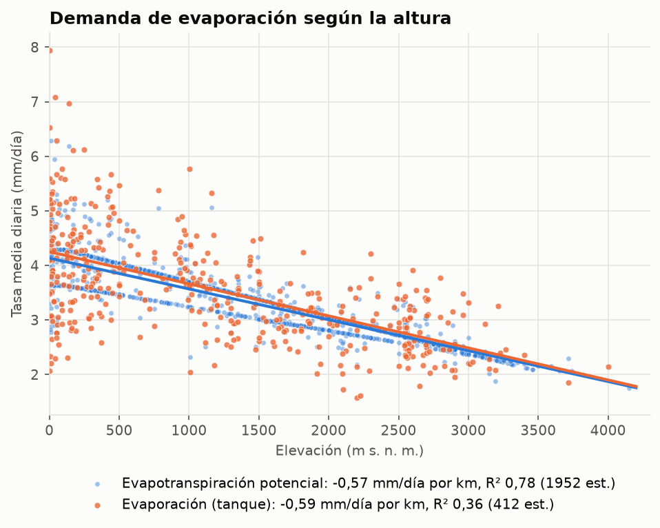
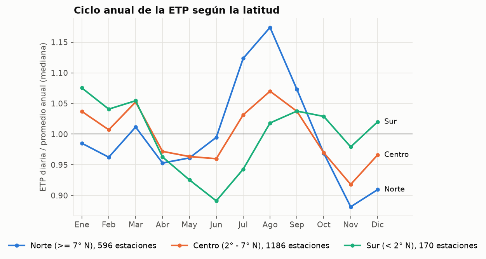
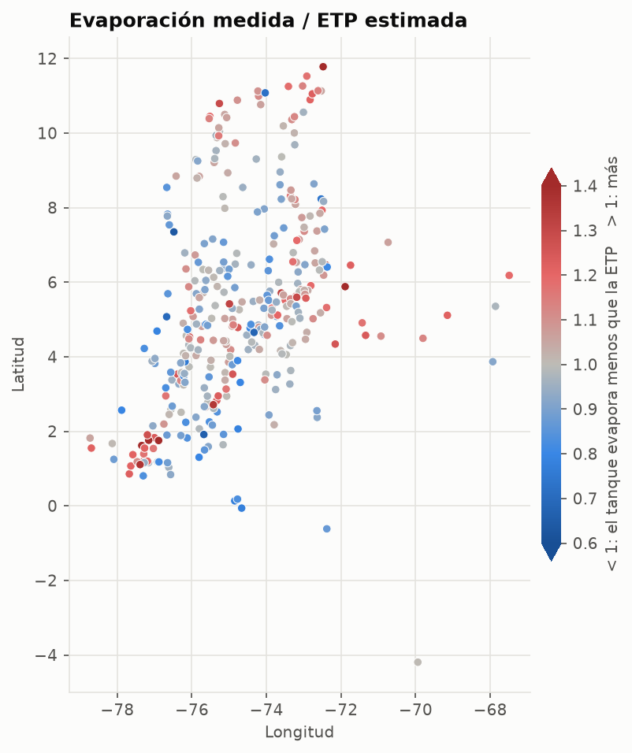
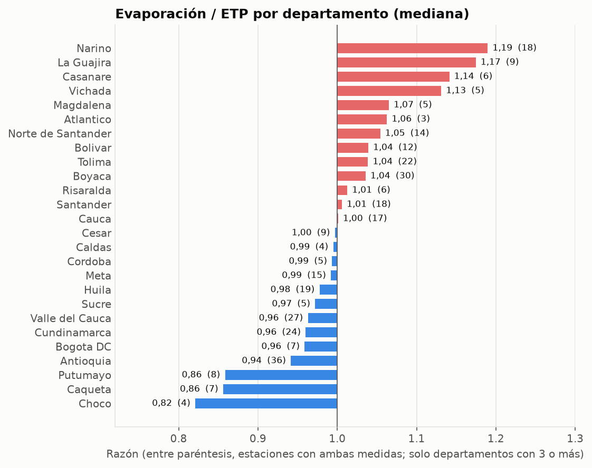

# Reporte: evaporación y evapotranspiración potencial, normales 1981-2010

Generado desde `data/warehouse/clima.duckdb` (capa gold), archivo `promedios_climatologicos_1981_2010.xlsx`
(sha256 `f3d3751e976756de…`). Los anuales son la suma de los 12 meses.

## Cifras generales

| Indicador | Valor |
|---|---|
| Estaciones con ETP | 1.952 |
| Estaciones con evaporación medida | 412 |
| Estaciones con ambas | 344 |
| ETP anual, mediana (mín - máx) | 1.316 mm (638 - 2.298) |
| Evaporación anual, mediana (mín - máx) | 1.251 mm (577 - 2.903) |
| Evaporación / ETP, mediana (p10 - p90) | 1,00 (0,85 - 1,21) |
| Cambio de la ETP con la altura | -0,57 mm/día por km (R² 0,78) |
| Cambio de la evaporación con la altura | -0,59 mm/día por km (R² 0,36) |
| Anual publicado de evaporación vs suma de meses | -6,5% en la mediana |

## Altura

| Piso térmico | Estaciones ETP | ETP mediana (mm) | Estaciones evaporación | Evaporación mediana (mm) | Evap. / ETP |
|---|---|---|---|---|---|
| Cálido (< 1.000 m) | 1035 | 1.478,20 | 196 | 1.485,88 | 1,00 |
| Templado (1.000 - 2.000 m) | 470 | 1.203,65 | 109 | 1.178,49 | 1,00 |
| Frío (2.000 - 3.000 m) | 384 | 981,30 | 93 | 1.022,33 | 1,01 |
| Páramo (>= 3.000 m) | 63 | 835,00 | 14 | 823,91 | 1,08 |

## Época del año

## Evaporación medida frente a la estimada

Estaciones con mayor y menor evaporación:

| Estación | Municipio | Departamento | Elevación (m) | Evaporación (mm/año) | ETP (mm/año) | Evap. / ETP |
|---|---|---|---|---|---|---|
| Manaure | Manaure | La Guajira | 1 | 2.902,77 | 1.739,90 | 1,67 |
| Gloria La | La Gloria | Cesar | 40 | 2.587,33 | - | - |
| Apto Alfonso Lopez | Valledupar | Cesar | 138 | 2.540,34 | 2.256,50 | 1,13 |
| Apto A.Padilla | Riohacha | La Guajira | 4 | 2.385,35 | 2.030,60 | 1,17 |
| Pto Paez | Puerto Carreno | Vichada | 53 | 2.290,62 | - | - |
| San Lorenzo | Santa Marta | Magdalena | 2200 | 577,25 | 797,60 | 0,72 |
| Cueva Los Guacharo | Acevedo | Huila | 2225 | 591,24 | - | - |
| Resina | Guadalupe | Huila | 2102 | 629,73 | 950,60 | 0,66 |
| Acapulco | Bojaca | Cundinamarca | 2650 | 650,89 | 957,50 | 0,68 |
| Sierra Nevad Cocuy | Guican | Boyaca | 3716 | 677,60 | 837,00 | 0,81 |

## Por departamento

| Departamento | Estaciones ETP | ETP mediana (mm) | Estaciones evaporación | Evaporación mediana (mm) | Evap. / ETP |
|---|---|---|---|---|---|
| Atlantico | 28 | 1.569,80 | 4 | 1.889,49 | 1,06 |
| Bolivar | 76 | 1.569,80 | 13 | 1.608,98 | 1,04 |
| La Guajira | 60 | 1.569,80 | 10 | 1.977,97 | 1,17 |
| Magdalena | 68 | 1.569,80 | 5 | 1.643,59 | 1,07 |
| San Andres Providencia y Sta C | 8 | 1.569,80 | 2 | 1.455,99 | 0,87 |
| Cesar | 69 | 1.565,50 | 10 | 1.791,51 | 1,00 |
| Sucre | 38 | 1.556,65 | 7 | 1.560,57 | 0,97 |
| Norte de Santander | 79 | 1.488,20 | 15 | 1.351,92 | 1,05 |
| Tolima | 128 | 1.407,65 | 22 | 1.563,89 | 1,04 |
| Huila | 122 | 1.342,30 | 21 | 1.307,11 | 0,98 |
| Santander | 112 | 1.337,40 | 19 | 1.266,20 | 1,01 |
| Choco | 37 | 1.329,10 | 6 | 935,79 | 0,82 |
| Cordoba | 72 | 1.329,10 | 7 | 1.428,70 | 0,99 |
| Guainia | 6 | 1.329,10 | 2 | 1.497,73 | 0,92 |
| Vichada | 21 | 1.329,10 | 6 | 1.596,94 | 1,13 |
| Amazonas | 22 | 1.325,60 | 2 | 1.120,10 | 1,00 |
| Guaviare | 4 | 1.319,80 | 3 | 1.217,07 | 0,91 |
| Vaupes | 7 | 1.315,40 | 1 | 1.084,30 | - |
| Casanare | 22 | 1.312,40 | 8 | 1.560,61 | 1,14 |
| Arauca | 4 | 1.309,40 | 2 | 1.589,02 | 1,14 |
| Caqueta | 20 | 1.308,35 | 7 | 1.130,14 | 0,86 |
| Meta | 56 | 1.291,55 | 17 | 1.370,02 | 0,99 |
| Valle del Cauca | 129 | 1.286,80 | 31 | 1.322,01 | 0,96 |
| Antioquia | 151 | 1.260,80 | 43 | 1.170,30 | 0,94 |
| Risaralda | 28 | 1.214,50 | 9 | 1.110,33 | 1,01 |
| Quindio | 3 | 1.191,70 | 1 | 1.356,21 | 1,14 |
| Cauca | 102 | 1.179,75 | 21 | 1.156,59 | 1,00 |
| Putumayo | 33 | 1.142,10 | 8 | 1.024,43 | 0,86 |
| Caldas | 35 | 1.113,50 | 6 | 996,95 | 0,99 |
| Narino | 61 | 1.061,90 | 20 | 1.182,09 | 1,19 |
| Boyaca | 144 | 1.002,00 | 37 | 1.152,12 | 1,04 |
| Cundinamarca | 162 | 977,90 | 36 | 921,23 | 0,96 |
| Bogota DC | 45 | 921,40 | 11 | 934,82 | 0,96 |

## Calidad de la carga

| Regla | Severidad | Estado | Fallidas / evaluadas |
|---|---|---|---|
| anual_consistente_evaporacion | advertencia | advertencia | 263 / 412 |
| estacion_consistente_entre_hojas | advertencia | advertencia | 1 / 344 |
| anual_consistente_evapotranspiracion_potencial | advertencia | ok | 0 / 1952 |
| categoria_conocida | advertencia | ok | 0 / 2364 |
| codigo_unico_por_hoja | error | ok | 0 / 2364 |
| coherencia_evaporacion_etp | advertencia | ok | 0 / 344 |
| coordenadas_en_colombia | error | ok | 0 / 2364 |
| coordenadas_legibles | error | ok | 0 / 2364 |
| elevacion_valida | error | ok | 0 / 2364 |
| identificacion_completa | error | ok | 0 / 2364 |
| rango_fisico_evaporacion | error | ok | 0 / 4944 |
| rango_fisico_evapotranspiracion_potencial | error | ok | 0 / 23424 |
| serie_completa_evaporacion | advertencia | ok | 0 / 412 |
| serie_completa_evapotranspiracion_potencial | advertencia | ok | 0 / 1952 |
| valores_numericos | error | ok | 0 / 28368 |
